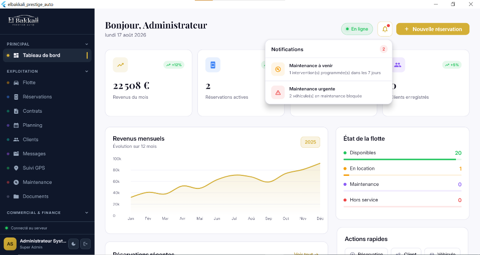

# El Bakkali Prestige Auto

## Vehicle Rental Management Platform

> A complete digital platform for premium vehicle rental operations, combining a responsive customer-facing website with a cross-platform management application, REST API and relational database.

[](https://flutter.dev/)
[](https://dart.dev/)
[](https://www.php.net/)
[](https://www.mysql.com/)
[](https://developer.mozilla.org/en-US/docs/Web/JavaScript)
[](https://developer.mozilla.org/en-US/docs/Web/HTML)
[](https://developer.mozilla.org/en-US/docs/Web/CSS)
[](https://getbootstrap.com/)
[](https://sqlite.org/)
[](https://git-scm.com/)
[](https://github.com/)

---

# Overview

**El Bakkali Prestige Auto** is a custom-built vehicle rental management platform developed for a premium rental business in **Meknes, Morocco**.

The project combines two complementary applications:

1. A **responsive PHP-based public website** for customers.
2. A **cross-platform Flutter management application** for internal operations.

The platform is supported by a **PHP REST API** and a **MySQL relational database**, while the Flutter application also integrates a local database to support offline data access and synchronization.

The system covers the main operational lifecycle of a vehicle rental business:

* Vehicle management
* Vehicle catalogue
* Vehicle availability
* Customer management
* Reservations
* Payment tracking
* Rental options
* Maintenance management
* Customer documents
* Document scanning
* Rental contracts
* PDF generation
* Dashboard and operational monitoring
* Offline data management
* Data synchronization
* Role-based access
* Authentication and authorization

---

# System Architecture

The overall platform follows a client-server architecture.

```text
                         EL BAKKALI PRESTIGE AUTO
                                  |
              +-------------------+-------------------+
              |                                       |
              v                                       v
     Customer Web Platform                    Management Application
              |                                       |
       PHP / HTML / CSS                         Flutter / Dart
       JavaScript / Bootstrap                  Riverpod / GoRouter
              |                                       |
              +-------------------+-------------------+
                                  |
                                  v
                           PHP REST API
                                  |
                       Authentication / JWT
                                  |
                     Business Logic / Validation
                                  |
                                  v
                              MySQL
                                  |
                       Centralized Data Layer
                                  |
                                  v
                         Local SQLite / Drift
                                  |
                         Offline / Sync Layer
```

---

# Platform Components

## Customer Website

The public website provides customers with a premium digital interface for:

* Browsing available vehicles
* Viewing vehicle details
* Checking availability
* Selecting rental dates
* Submitting reservation requests
* Discovering rental services
* Viewing promotional offers
* Contacting the company
* Selecting a language
* Accessing rental conditions

---

## Management Application

The Flutter application is designed for internal vehicle rental operations.

It provides dedicated workflows for:

* Dashboard
* Vehicles
* Customers
* Reservations
* Payments
* Maintenance
* Incidents
* Documents
* Contracts
* PDF generation
* User management
* Offline operation
* Data synchronization

The application supports multiple platforms through Flutter.

---

# Technology Stack

## Frontend — Web

* HTML5
* CSS3
* JavaScript
* Bootstrap 5
* JSON
* Responsive Web Design
* Custom CSS Design System

---

## Mobile & Cross-Platform Application

* Flutter
* Dart
* Riverpod
* GoRouter
* Dio
* SQLite
* Drift
* Google ML Kit
* Connectivity Plus
* PDF generation
* Cross-platform application architecture

---

## Backend

* PHP 8.x
* REST API
* PDO
* JWT Authentication
* JSON
* Server-side validation
* Business logic
* API routing
* Middleware

---

## Database

* MySQL 8.x
* SQL
* Relational database architecture
* SQLite
* Drift
* Database synchronization

---

## Development Environment

* Visual Studio Code
* Android Studio
* XAMPP
* Apache
* MySQL
* phpMyAdmin
* Git
* GitHub
* Postman

---

# Web Application

## Website Features

The website is designed as a complete digital storefront for the rental business.

### Main Pages

```text
index.php
catalogue.php
vehicle.php
promo.php
reservations.php
garanties.php
contact.php
services.php
service-aeroport.php
service-ville.php
service-lmd.php
service-lld.php
```

---

# Vehicle Catalogue

The catalogue supports several vehicle categories:

* Cars
* Motorcycles
* Personal watercraft

## Catalogue Features

* Vehicle listing
* Category filtering
* Brand filtering
* Year filtering
* Color filtering
* Transmission filtering
* Date-based filtering
* Promotional filtering
* Pagination
* Vehicle detail navigation
* Availability-oriented browsing

The current catalogue configuration contains **12 vehicles**, with **9 vehicles displayed per page**.

---

# Vehicle Details

Each vehicle can have a dedicated detail page containing:

* Vehicle image gallery
* Vehicle specifications
* Vehicle information
* Availability checker
* Pickup location
* Rental dates
* Rental time
* Reservation action
* Phone contact
* WhatsApp contact
* Related vehicles

---

# Booking System

A centralized booking card is available throughout the website.

The booking interface supports:

* Pickup city
* Return city
* Moroccan city selection
* Moroccan airport selection
* Pickup date
* Return date
* Rental duration calculation
* Date-based catalogue filtering
* Redirect to the catalogue with selected filters

---

# Reservation Workflow

The reservation system follows a structured **7-step workflow**.

## Step 1 — Rental Details

* Pickup date
* Return date
* Pickup location
* Return location
* Delivery mode

## Step 2 — Vehicle

* Vehicle selection
* Vehicle type filtering

## Step 3 — Additional Options

Examples include:

* Baby seat
* GPS
* Additional rental options

## Step 4 — Customer Information

* Customer contact information
* Reservation information

## Step 5 — Rental Conditions

* Rental terms
* Conditions acceptance

## Step 6 — Payment

* Payment method
* Payment information

## Step 7 — Confirmation

* Reservation code
* Complete reservation summary
* Printable receipt

---

# Reservation Receipt

After completing a reservation, the website generates a print-friendly reservation summary.

The receipt can contain:

* Reservation code
* Customer information
* Vehicle information
* Rental dates
* Rental details
* Reservation summary
* Printable layout

---

# Rental Services

Dedicated pages are provided for different rental services.

## Airport Delivery

```text
service-aeroport.php
```

Provides information related to airport vehicle delivery.

## City Delivery

```text
service-ville.php
```

Provides information related to city delivery.

## Medium-Term Rental

```text
service-lmd.php
```

Provides information related to medium-term rental services.

## Long-Term Rental

```text
service-lld.php
```

Provides information related to long-term rental services.

---

# Promotions

The platform includes a dedicated promotional system.

Features include:

* Promotional offers
* Discount percentage badges
* Promotional dates
* Calendar indicators
* Countdown display
* Vehicle type filtering

Promotional information is currently configured as website data rather than being edited directly from the public interface.

---

# Multilingual System

The website supports **8 languages**:

* French
* English
* Arabic
* Spanish
* Dutch
* German
* Italian
* Russian

Translation files are organized under:

```text
lang/
├── fr.json
├── en.json
├── ar.json
├── es.json
├── nl.json
├── de.json
├── it.json
└── ru.json
```

## Internationalization Features

* Language selector
* JSON-based translations
* Persistent language selection
* Multilingual navigation
* Multilingual interface
* Automatic RTL layout for Arabic

---

# Theme System

The website provides multiple visual modes:

* Dark theme
* Light theme
* Automatic/system theme

The selected preference can be persisted for future visits.

---

# Moroccan Locations

The booking interface contains:

* **80+ Moroccan cities**
* **18 configured airport entries**

Configured airport codes include:

```text
CMN
RBA
RAK
AGA
TNG
FEZ
OUD
NDR
VIL
EUN
ESU
ERH
TTU
OZZ
MEK
GMD
BEM
SFI
```

---

# SEO

The website includes several technical SEO implementations.

## Metadata

* Meta descriptions
* Open Graph
* Twitter Cards

## Structured Data

* JSON-LD
* LocalBusiness
* AutoRental structured data

## Search Engine Files

```text
sitemap.xml
robots.txt
```

The sitemap is intended to be updated with the production domain before deployment.

---

# Design System

The website uses a premium dark-oriented visual identity.

| Element      | Value              |
| ------------ | ------------------ |
| Primary Gold | `#C8A96E`          |
| Main Black   | `#080808`          |
| Card Black   | `#111111`          |
| Display Font | Cormorant Garamond |
| Body Font    | Outfit             |

The design system focuses on:

* Premium visual identity
* Responsive layouts
* Typography hierarchy
* Consistent spacing
* Reusable components
* Dark/light theme support
* Mobile navigation

---

# Management Application

The Flutter application centralizes internal rental operations.

## Dashboard

The management dashboard provides an operational overview of the business.

Possible information includes:

* Reservations
* Vehicles
* Customers
* Rental activity
* Operational statistics
* Vehicle availability
* Maintenance status

---

# Vehicle Management

The management application provides centralized vehicle operations.

Features include:

* Create vehicle records
* Update vehicle information
* Delete vehicle records
* Search vehicles
* Filter vehicles
* Track vehicle availability
* Track vehicle status
* Track mileage
* Track maintenance information
* Associate vehicles with reservations

---

# Customer Management

Customer records can be managed directly from the application.

Features include:

* Customer profiles
* Personal information
* Contact information
* Driving license information
* Identity document information
* Passport information
* Document management
* Document scanning
* Reservation history
* Customer-reservation association

---

# Maintenance Management

The platform provides vehicle maintenance tracking.

Features include:

* Maintenance records
* Maintenance status
* Maintenance history
* Vehicle operational status
* Maintenance-related information

The maintenance module helps keep track of the operational condition of vehicles and their availability.

---

# Incident Management

The management application can be used to maintain information related to vehicle incidents and operational events.

Incident-related information can be associated with:

* Vehicles
* Customers
* Reservations
* Operational records

---

# Payment Management

Payments are associated with reservations.

The backend provides dedicated API operations for payment management.

Example:

```http
POST /api/v1/reservations/:id/payments
```

The system is designed to maintain payment-related information within the reservation lifecycle.

---

# Documents & Contracts

The platform integrates document-related functionality into the rental workflow.

Features include:

* Customer document management
* Document scanning
* Document information
* Rental contract generation
* PDF generation
* Digital document handling

---

# Document Scanning

The Flutter application integrates **Google ML Kit** for document-scanning-related functionality.

This can support workflows where physical customer documents need to be captured and processed through the application.

---

# PDF Generation

The application supports PDF generation for rental-related documents.

Potential generated documents include:

* Rental contracts
* Reservation documents
* Operational documents
* Customer-related documents

---

# Offline Architecture

The Flutter application incorporates local storage to support operation when network connectivity is temporarily unavailable.

The local data layer uses:

* SQLite
* Drift

---

## Offline Consultation

Previously synchronized data can remain available locally.

```text
        REST API
            |
            | Synchronization
            v
       SQLite / Drift
            |
            v
     Flutter Application
```

---

## Offline Operations

Supported operations can be stored locally when the network is unavailable.

```text
User Action
     |
     v
SQLite / Drift
     |
     v
Local Pending Operation
     |
     v
Synchronization Queue
```

---

## Synchronization

When connectivity is restored, pending operations can be synchronized with the server.

```text
SQLite / Drift
      |
      | Pending Changes
      v
   REST API
      |
      v
    MySQL
```

The synchronization architecture uses timestamps and synchronization logic to handle local and server-side changes.

---

# Connectivity Management

The Flutter application uses **Connectivity Plus** to detect network connectivity changes and support the offline/online workflow.

The general flow is:

```text
Network Available
       |
       v
    REST API
       |
       v
     MySQL


Network Unavailable
       |
       v
  Local SQLite
       |
       v
 Pending Changes
       |
       v
Synchronization
```

---

# Authentication

The backend implements JWT-based authentication.

Authentication can be structured around:

```text
Login
  |
  v
Access Token
  |
  v
Authenticated API Requests
  |
  v
Token Refresh
```

Available authentication operations include:

```http
POST /api/v1/auth/login
POST /api/v1/auth/refresh
POST /api/v1/auth/logout
GET  /api/v1/auth/me
```

---

# Authorization & Roles

The application is designed around role-based access.

Role-based access control can be used to separate administrative operations from employee-level operations.

This provides a foundation for:

* Administrative access
* Employee access
* Protected management operations
* Restricted API resources

---

# Security Architecture

Security is implemented across multiple layers.

## Application Security

* JWT authentication
* Access tokens
* Refresh tokens
* Token rotation
* Password hashing
* Role-based access control
* Server-side validation

## Database Security

* PDO prepared statements
* Parameterized queries
* Input validation
* Controlled database access

## HTTP Security

The backend can be configured with security headers such as:

* Content Security Policy
* HSTS
* X-Frame-Options
* CORS policies

## Data Protection

Sensitive configuration is separated from source code through environment-based configuration.

Secrets that must never be committed include:

```text
.env
Database passwords
JWT secrets
API keys
Private keys
Production credentials
```

---

# REST API

The PHP backend exposes a RESTful API organized around the platform's primary resources.

## Authentication

| Method | Endpoint               | Description                  |
| ------ | ---------------------- | ---------------------------- |
| POST   | `/api/v1/auth/login`   | Authenticate a user          |
| POST   | `/api/v1/auth/refresh` | Refresh authentication token |
| POST   | `/api/v1/auth/logout`  | Logout                       |
| GET    | `/api/v1/auth/me`      | Retrieve current user        |

## Vehicles

| Method | Endpoint                        | Description        |
| ------ | ------------------------------- | ------------------ |
| GET    | `/api/v1/vehicles`              | List vehicles      |
| GET    | `/api/v1/vehicles/availability` | Check availability |
| POST   | `/api/v1/vehicles`              | Create vehicle     |
| PUT    | `/api/v1/vehicles/:id`          | Update vehicle     |
| DELETE | `/api/v1/vehicles/:id`          | Delete vehicle     |

## Clients

| Method | Endpoint              | Description   |
| ------ | --------------------- | ------------- |
| GET    | `/api/v1/clients`     | List clients  |
| POST   | `/api/v1/clients`     | Create client |
| PUT    | `/api/v1/clients/:id` | Update client |

## Reservations

| Method | Endpoint                            | Description        |
| ------ | ----------------------------------- | ------------------ |
| GET    | `/api/v1/reservations`              | List reservations  |
| POST   | `/api/v1/reservations`              | Create reservation |
| PUT    | `/api/v1/reservations/:id`          | Update reservation |
| POST   | `/api/v1/reservations/:id/payments` | Add payment        |

## Synchronization

| Method | Endpoint            | Description             |
| ------ | ------------------- | ----------------------- |
| POST   | `/api/v1/sync/push` | Push local changes      |
| GET    | `/api/v1/sync/pull` | Retrieve server changes |

---

# API Data Format

The API communicates using JSON.

Example request:

```json
{
  "vehicle_id": 12,
  "client_id": 5,
  "pickup_date": "2026-09-25",
  "return_date": "2026-09-28"
}
```

Example response:

```json
{
  "success": true,
  "data": {
    "reservation_id": 125,
    "status": "pending"
  }
}
```

---

# Database Architecture

The system uses **MySQL** as its centralized relational database.

The database is designed to organize entities such as:

```text
Users
Vehicles
Clients
Reservations
Payments
Maintenance
Documents
Incidents
Contracts
Synchronization
```

The Flutter application uses a local SQLite/Drift database for offline functionality.

---

# Project Structure

```text
elbakkali_prestige_auto/
│
├── database/
│   └── schema.sql
│
├── backend/
│   │
│   ├── config/
│   │   ├── database.php
│   │   └── jwt.php
│   │
│   ├── middleware/
│   │   ├── SecurityMiddleware.php
│   │   └── AuthMiddleware.php
│   │
│   ├── helpers/
│   │   └── helpers.php
│   │
│   ├── controllers/
│   │   ├── AuthController.php
│   │   ├── VehiclesController.php
│   │   ├── ClientsController.php
│   │   ├── ReservationsController.php
│   │   └── SyncController.php
│   │
│   ├── router/
│   │   └── Router.php
│   │
│   └── public/
│       ├── index.php
│       └── .htaccess
│
├── flutter_app/
│   │
│   ├── pubspec.yaml
│   │
│   └── lib/
│       │
│       ├── main.dart
│       │
│       ├── core/
│       │   ├── api/
│       │   ├── database/
│       │   ├── sync/
│       │   ├── theme/
│       │   ├── router/
│       │   ├── di/
│       │   └── widgets/
│       │
│       └── features/
│           ├── auth/
│           ├── dashboard/
│           ├── vehicles/
│           ├── reservations/
│           ├── clients/
│           ├── scanner/
│           └── pdf/
│
├── web/
│   ├── index.php
│   ├── catalogue.php
│   ├── vehicle.php
│   ├── reservations.php
│   ├── services.php
│   ├── contact.php
│   ├── promo.php
│   ├── garanties.php
│   ├── service-aeroport.php
│   ├── service-ville.php
│   ├── service-lmd.php
│   └── service-lld.php
│
├── lang/
│   ├── fr.json
│   ├── en.json
│   ├── ar.json
│   ├── es.json
│   ├── nl.json
│   ├── de.json
│   ├── it.json
│   └── ru.json
│
├── assets/
│   └── logo1.png
│
├── .env.example
├── .gitignore
├── LICENSE
└── README.md
```

---

# Installation

## Requirements

Install the following tools:

* PHP 8.1+
* MySQL 8.0+
* Apache
* PHP PDO extension
* mod_rewrite
* Flutter SDK
* Dart SDK
* Android Studio
* Git
* phpMyAdmin
* Visual Studio Code

---

# Clone the Repository

```bash
git clone https://github.com/your-username/elbakkali-prestige-auto.git
```

Move into the project directory:

```bash
cd elbakkali-prestige-auto
```

---

# Web Installation with XAMPP

Copy the project into:

```text
C:\xampp\htdocs\elbakkali\
```

Start the following services from the XAMPP Control Panel:

```text
Apache
MySQL
```

---

# Database Setup

Open:

```text
http://localhost/phpmyadmin/
```

Create the database:

```text
elbakkali_db
```

Import:

```text
database/schema.sql
```

---

# Backend Configuration

Create your local environment configuration based on:

```text
.env.example
```

Example:

```env
DB_HOST=localhost
DB_NAME=elbakkali_db
DB_USER=root
DB_PASS=

JWT_SECRET=your_secure_secret

CORS_ORIGINS=http://localhost
```

Never commit production credentials to GitHub.

---

# Running the Website

Open:

```text
http://localhost/elbakkali/
```

---

# Running the Flutter Application

Navigate to the application directory:

```bash
cd flutter_app
```

Install dependencies:

```bash
flutter pub get
```

If code generation is required:

```bash
dart run build_runner build --delete-conflicting-outputs
```

Check available devices:

```bash
flutter devices
```

Run the application:

```bash
flutter run
```

---

# Development Workflow

The application follows a layered development workflow:

```text
Requirements
      |
      v
Analysis
      |
      v
UI / UX
      |
      v
Architecture
      |
      v
Frontend / Flutter
      |
      v
REST API
      |
      v
Business Logic
      |
      v
Database
      |
      v
Testing
      |
      v
Security
      |
      v
Deployment
      |
      v
Monitoring & Maintenance
```

---

# Engineering Concepts Demonstrated

This project brings together several software and infrastructure concepts:

* Client-server architecture
* RESTful API architecture
* Object-oriented programming
* Modular application architecture
* Relational database design
* SQL
* Authentication
* Authorization
* Role-Based Access Control
* JWT
* Password hashing
* API validation
* Secure database access
* Offline-first concepts
* Local data persistence
* Data synchronization
* PDF generation
* Document scanning
* Responsive web design
* Internationalization
* RTL support
* SEO
* Structured data
* Infrastructure-oriented application design

---

# Project Objectives

The platform was designed to:

1. Digitize vehicle rental operations.
2. Centralize vehicle information.
3. Centralize customer information.
4. Simplify reservation management.
5. Track vehicle availability.
6. Manage payments.
7. Track maintenance.
8. Manage customer documents.
9. Generate rental contracts.
10. Support offline application usage.
11. Synchronize local and server-side data.
12. Provide role-based management.
13. Improve the customer-facing digital experience.
14. Provide a scalable foundation for future development.

---

# Future Improvements

Potential improvements include:

* Advanced analytics
* Business intelligence dashboards
* Automated reports
* Push notifications
* Automated reservation reminders
* Online payment gateway integration
* Cloud deployment
* Docker containerization
* CI/CD pipeline
* Automated testing
* Advanced audit logging
* Advanced synchronization conflict resolution
* More granular permissions
* Advanced monitoring and observability
* Production-grade backup and disaster recovery

---

# Security Guidelines

Before deploying the application to production:

* Enable HTTPS.
* Use strong database credentials.
* Generate a secure JWT secret.
* Restrict CORS origins.
* Disable development/debug mode.
* Configure secure HTTP headers.
* Protect environment variables.
* Restrict database access.
* Configure database backups.
* Review authentication and authorization rules.
* Monitor application and API logs.
* Keep dependencies and server software updated.

Never publish:

```text
Database passwords
JWT secrets
API keys
Private keys
Production credentials
Client confidential information
Internal infrastructure information
```

---

# Screenshots

Screenshots can be added to document the application interface.

Recommended screenshots:

```text
screenshots/
├── website-home.png
├── catalogue.png
├── vehicle-details.png
├── reservation.png
├── dashboard.png
├── vehicles.png
├── clients.png
├── reservations.png
├── maintenance.png
├── document-scanner.png
└── contract-pdf.png
```

Example:

```markdown

```

---

# Project Information

| Property                | Details                            |
| ----------------------- | ---------------------------------- |
| Project                 | El Bakkali Prestige Auto           |
| Type                    | Vehicle Rental Management Platform |
| Domain                  | Vehicle Rental                     |
| Location                | Meknes, Morocco                    |
| Architecture            | Client / Server                    |
| Web                     | PHP / HTML / CSS / JavaScript      |
| Mobile                  | Flutter / Dart                     |
| Backend                 | PHP REST API                       |
| Database                | MySQL                              |
| Local Database          | SQLite / Drift                     |
| Authentication          | JWT                                |
| API Format              | JSON                               |
| Development Environment | XAMPP                              |
| Version                 | v8                                 |

---

# License

This repository is provided for educational, demonstration and portfolio purposes.

If the repository contains proprietary client code, assets or business information, the applicable client ownership and usage terms take precedence.

---

# Author

## Khaoula Belhaj

Engineering Student — Communication Systems & Cybersecurity

Areas of interest:

* Cybersecurity
* Network Engineering
* Cloud Infrastructure
* Systems Engineering
* Software Engineering
* Full-Stack Development
* IoT
* DevOps
* Secure Systems Architecture

For professional opportunities and technical collaboration, please refer to the developer's GitHub and LinkedIn profiles.

---

<p align="center">
  <strong>El Bakkali Prestige Auto</strong>
  <br>
  Vehicle Rental Management Platform
  <br><br>
  <em>Web Platform · Flutter Application · REST API · MySQL</em>
</p>
